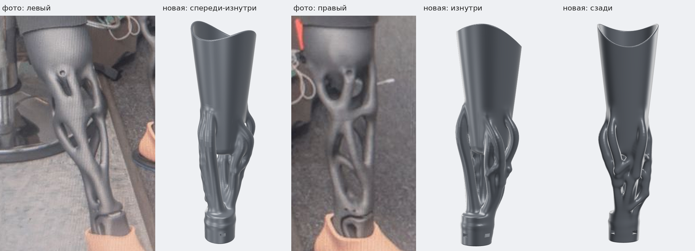
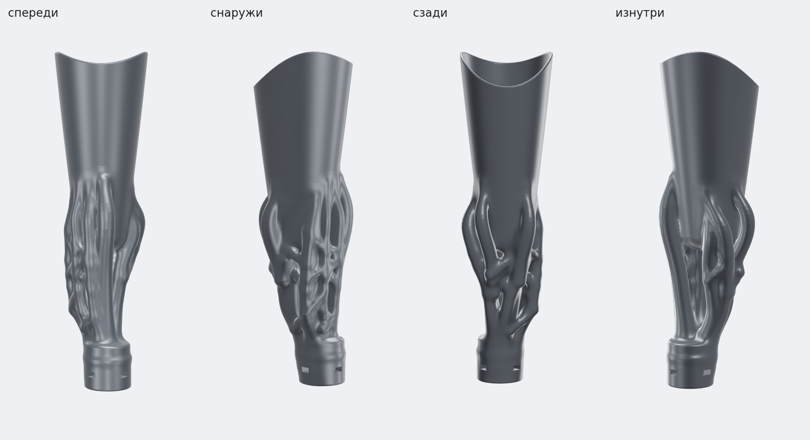
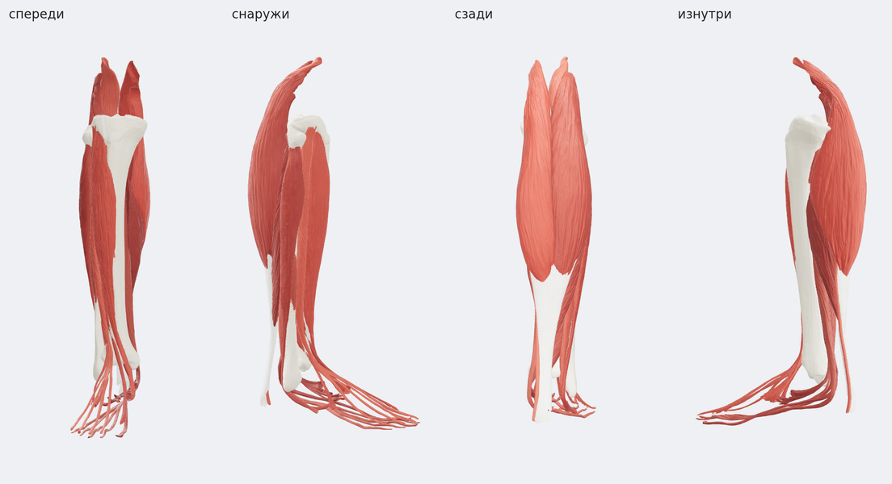

# Анатомическая версия: ветви по мышцам реальной правой ноги

**Статус:** черновик, согласуем внешний вид.

Сочетание примерно 60/40:
- **60 % от референса:** толстые гладкие ветви с перепонками, гладкая гильза с сужающейся воронкой снизу, узкая горловина и цилиндр щиколотки;
- **40 % анатомии:** ветви повторяют реальные мышцы и кости правой голени.





- `stl/organic_leg_full.stl` — макет целиком: 99 × 107 × 358 мм, одно замкнутое тело, ~780 см³. Внизу 4 отверстия M6 и пазы для гаек под адаптер стопы, как в основной модели.
- `build_organic_leg.py` — генератор этой версии.
- `anatomy_tubes.py` — раскладка мышц на трубки по их реальным сечениям.
- `build_cyber_leg.py` — промежуточная «кабельная» версия: сотни тонких трубок с хомутами. Из неё берутся гильза и обжатие мышц вокруг неё.

## Откуда анатомия

Мышцы и кости правой голени взяты из открытой базы [BodyParts3D](https://github.com/Kevin-Mattheus-Moerman/BodyParts3D), построенной по данным реального человека:

- две головки икроножной мышцы, камбаловидная, ахиллово сухожилие;
- передняя большеберцовая, длинный разгибатель пальцев, длинная малоберцовая;
- большеберцовая и малоберцовая кости.



> BodyParts3D, (c) The Database Center for Life Science, licensed under CC Attribution-Share Alike 2.1 Japan.
> Модели этой папки производные: распространять их можно только с этой ссылкой и под той же лицензией (CC BY-SA).

## Как пересобрать

```bash
pip install -r ../requirements.txt shapely
git clone --depth 1 https://github.com/Kevin-Mattheus-Moerman/BodyParts3D
python build_organic_leg.py --anatomy BodyParts3D/assets/BodyParts3D_data/stl --out stl
```

Сборка занимает около 30 секунд. Толщина ветвей, их число на мышцу, мягкость слияний и форма воронки задаются константами в начале `build_organic_leg.py`.
