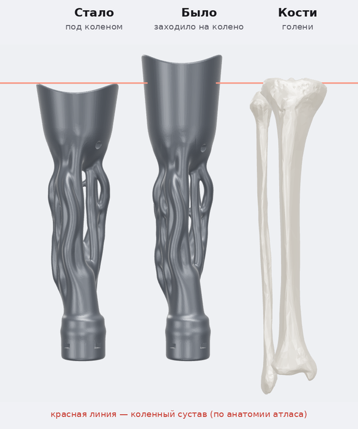

# Анатомическая версия: ветви по мышцам реальной правой ноги

**Статус:** черновик, согласуем внешний вид. Сейчас выбрана раскладка `s2`.

Стиль референса, но ветви идут по реальным мышцам и костям правой голени:
- протез занимает только голень: короткая гильза-чашка начинается сразу под коленом (передний край на 12 мм ниже коленного сустава), под ней решётка-«икра» и щиколотка;
- низ гильзы — яйцевидный овал без шва с маленьким круглым отверстием, как на фото;
- ветви тонкие (Ø9–13 мм) и извилистые, со свитыми парами и плавными Y-развилками;
- над щиколоткой гладкая сужающаяся «ножка».




- `stl/organic_leg_full.stl` — макет целиком: 95 × 98 × 316 мм, одно замкнутое тело, ~495 см³. Внизу 4 отверстия M6 и пазы для гаек под адаптер стопы, как в основной модели.
- `build_organic_leg.py` — генератор этой версии.
- `anatomy_tubes.py` — раскладка мышц на трубки по их реальным сечениям.
- `build_cyber_leg.py` — промежуточная «кабельная» версия: сотни тонких трубок с хомутами. Из неё берутся параметры гильзы и обжатие мышц вокруг неё.

## Раскладки связок

Набор мышц один, а как идут связки, задаёт `--layout`. Например:
- `s2` (по умолчанию) — связки по ходу мышц, гильза гладкая;
- `anatomy` — то же, но связки поднимаются по гильзе рельефом;
- `spiral`, `tornado`, `weave` — пучок закручен вокруг голени;
- `fan`, `strings` — связки разведены по кругу ровнее;
- `tripod`, `thick5`, `thick7`, `thickfork`, `ropes` — редкие толстые связки;
- `dense`, `web`, `web2`, `gossamer` — густые тонкие, вплоть до паутины;
- `mixed` — две мощные стойки и паутина между ними.

Полный список с описаниями — в словаре `LAYOUTS` в `build_organic_leg.py`.

## Откуда анатомия

Мышцы и кости правой голени взяты из открытой базы [BodyParts3D](https://github.com/Kevin-Mattheus-Moerman/BodyParts3D), построенной по данным реального человека:

- две головки икроножной мышцы, камбаловидная, ахиллово сухожилие;
- передняя большеберцовая, длинный разгибатель пальцев, длинная малоберцовая;
- большеберцовая и малоберцовая кости. По верхушке большеберцовой кости находится колено, и гильза ставится под ним.


> BodyParts3D, (c) The Database Center for Life Science, licensed under CC Attribution-Share Alike 2.1 Japan.
> Модели этой папки производные: распространять их можно только с этой ссылкой и под той же лицензией (CC BY-SA).

## Как пересобрать

```bash
pip install -r ../requirements.txt shapely
git clone --depth 1 https://github.com/Kevin-Mattheus-Moerman/BodyParts3D
python build_organic_leg.py --anatomy BodyParts3D/assets/BodyParts3D_data/stl --out stl
python build_organic_leg.py --anatomy BodyParts3D/assets/BodyParts3D_data/stl --out stl --layout tripod   # другая раскладка
```

Сборка занимает около минуты. Положение гильзы относительно колена (`RIM_BELOW_KNEE`), её глубина (`SOCKET_DEPTH`), толщина ветвей, мягкость слияний и форма овала задаются константами в начале `build_organic_leg.py`.
